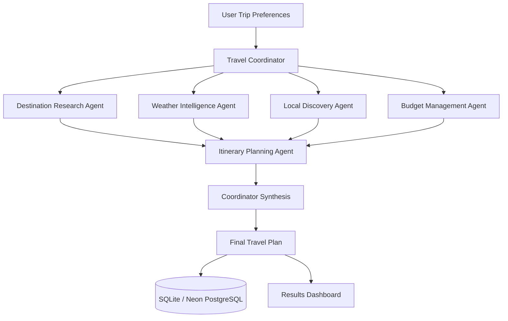
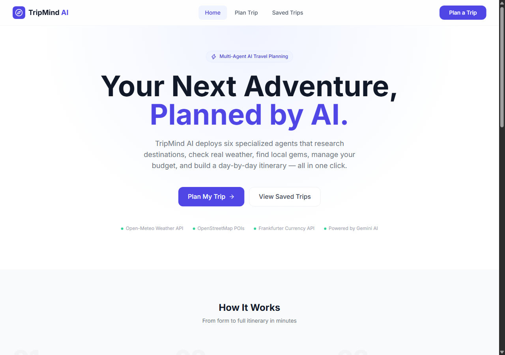
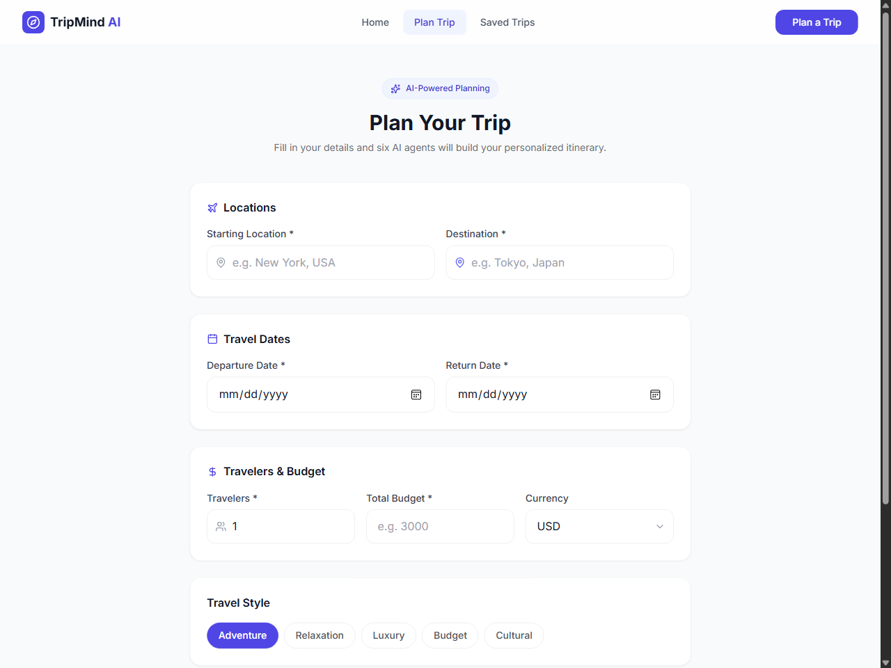
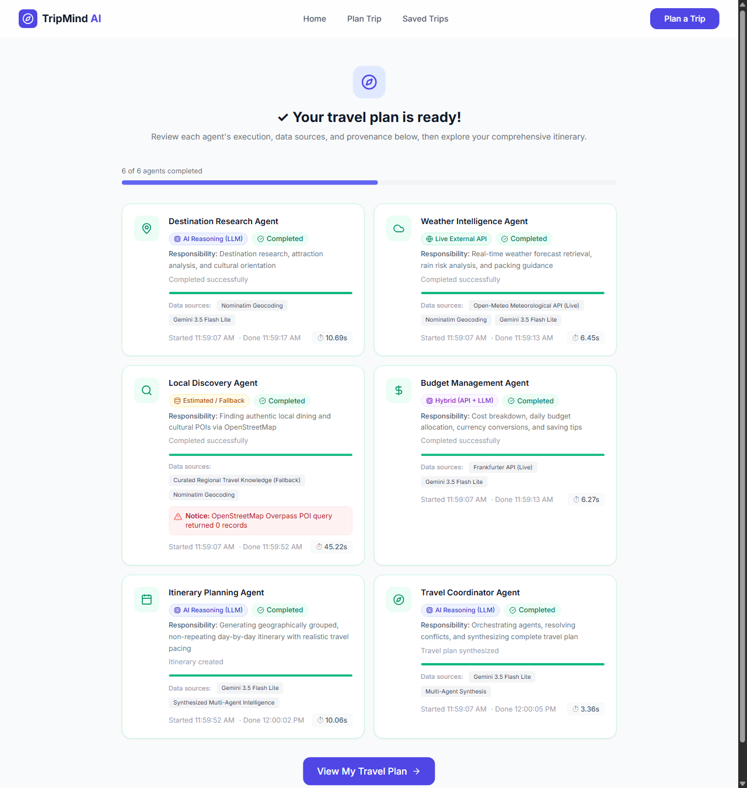
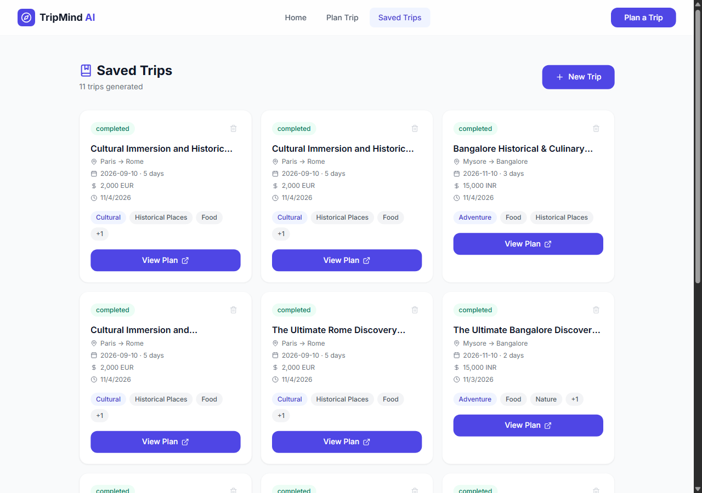

# TripMind AI 🧭

<p align="center">
  <strong>Your personal travel-planning team, powered by collaborating AI agents.</strong>
  <br />
  Research destinations, understand the weather, estimate costs, and build a day-by-day itinerary in one place.
</p>

<p align="center">
  <a href="https://trip-mind-ai-vert.vercel.app"></a>
  
  
  
  
  
  
  
</p>

<p align="center">
  <a href="https://trip-mind-ai-vert.vercel.app"><strong>🌐 Live Web Application</strong></a> •
  <a href="https://tripmind-ai-backend-a72w.onrender.com/docs"><strong>📖 Interactive API Documentation</strong></a> •
  <a href="https://tripmind-ai-backend-a72w.onrender.com/api/health/db"><strong>🔍 Live DB Health Probe</strong></a>
</p>

---

## Overview

**TripMind AI** is a deployed, production-grade multi-agent travel-planning application built with React 19, FastAPI, SQLAlchemy 2 Async, and Google Gemini. The architecture features five specialized agents and one Travel Coordinator (six agents total). The Travel Coordinator orchestrates the five specialized agents to research destinations, retrieve live weather forecasts, discover verified points of interest, compute category-wise budgets with currency conversions, and synthesize a cohesive day-by-day itinerary.

The application is deployed across modern cloud infrastructure:
- **Frontend:** [Vercel](https://trip-mind-ai-vert.vercel.app) (React 19 + Vite SPA)
- **Backend:** [Render](https://tripmind-ai-backend-a72w.onrender.com) (FastAPI Web Service with asyncpg)
- **Database:** [Neon](https://neon.tech) (Serverless PostgreSQL with SSL and connection pooling)

TripMind AI is architected around **transparent, evidence-aware recommendations** and a strict **zero-fabrication policy**:
- Every agent output includes standardized provenance metadata identifying whether information originated from an LLM, a live external API, a hybrid synthesis, or local domain fallback logic.
- If live geospatial or place-discovery services are unavailable, TripMind AI clearly flags records as unverified or provides regional cultural advice rather than inventing synthetic establishment names, addresses, or coordinates.
- Dual-database support provides seamless local development using SQLite (`aiosqlite`) and scalable production persistence via Neon PostgreSQL (`asyncpg`).
- All generated travel plans and agent execution records are persisted in the database and accessible via the Saved Trips dashboard.

> **Deployment & Verification Status:** TripMind AI is deployed and operational in production. Previously recorded test suite runs confirm **54 passing backend tests** (`pytest backend/tests`), **19 passing frontend unit tests** (`vitest run` in `frontend/`), and a successful Vite production build.

---

## Key Features

- **Multi-Agent Orchestration** — Five specialized agents and one Travel Coordinator (six agents total) coordinate to produce structured travel plans.
- **Destination Research** — Destination context, cultural highlights, top attractions, and practical travel guidance.
- **Weather Intelligence** — Live forecast retrieval from Open-Meteo, with packing suggestions and weather-aware advice.
- **Local Discovery** — Authentic points of interest and dining suggestions via OpenStreetMap Overpass and Nominatim.
- **Budget Planning** — Category-wise cost allocations, expense feasibility analysis, and currency conversion with live exchange rates from Frankfurter.
- **Day-Wise Itinerary** — Chronologically and geographically grouped morning, afternoon, and evening schedules.
- **Agent Transparency Dashboard** — Real-time execution tracking showing agent status, duration, source type, data sources, and errors.
- **Interactive Map** — Leaflet map with custom markers for verified places and coordinate-accurate POIs.
- **Visual Analytics** — Recharts visualizations for budget distribution and temperature/precipitation forecasts.
- **Dual-Database Persistence** — SQLite (`aiosqlite`) for zero-configuration local development; Neon PostgreSQL (`asyncpg`) with connection pooling for production.
- **Strict No-Fabrication Policy** — Unavailable POIs or weather dates are honestly reported; synthetic business names, artificial offsets, and fabricated coordinates are prohibited.
- **Graceful Fallback Resilience** — Domain-specific curated fallback behaviors keep the application functional even during third-party API rate limits or outages.

---

## How the Multi-Agent Workflow Works

The user enters their origin, destination, travel dates, traveler count, budget, currency, travel style, and interests. The Travel Coordinator dispatches concurrent research tasks, gathers the results, feeds them into the Itinerary Planning Agent, and synthesizes the final comprehensive itinerary.



### Five Specialized Agents and One Travel Coordinator (Six Agents Total)

| Agent | Responsibility | Data Sources & Tools |
|---|---|---|
| **Destination Research** | Destination overview, cultural context, attractions, and practical travel tips | Google Gemini; Nominatim geocoding |
| **Weather Intelligence** | Live forecast retrieval, packing suggestions, and weather-aware activity recommendations | Open-Meteo API; optional LLM interpretation |
| **Local Discovery** | Authentic points of interest, dining recommendations, and regional cuisine | OpenStreetMap Overpass & Nominatim; curated regional fallback |
| **Budget Management** | Cost allocations, budget feasibility checks, and multi-currency conversions | Frankfurter API; calculation logic; optional LLM analysis |
| **Itinerary Planning** | Chronological day-by-day scheduling, activity grouping, and geographic pacing | Google Gemini synthesized with upstream agent outputs |
| **Travel Coordinator** | Pipeline orchestration, progress event streaming, and final plan synthesis | Google Gemini; coordinator state machine |

### Transparent Agent Provenance

Every agent result attaches a provenance block visible in the Agent Execution Dashboard:

- `llm` — Generated using the configured language model.
- `live_api` — Retrieved directly from an external live data provider.
- `hybrid` — Synthesizes live external data with LLM reasoning.
- `fallback` — Derived from curated, local domain knowledge when a live external dependency is unavailable.

A completed agent status communicates task completion; provenance badges explicitly indicate whether data was live, hybrid, or fallback.

---

## Technology Stack

| Layer | Technologies |
|---|---|
| **Frontend** | React 19, Vite 8, Tailwind CSS |
| **Routing & HTTP** | React Router 7, Axios |
| **UI Components & Icons** | Lucide React |
| **Data Visualizations** | Recharts |
| **Interactive Maps** | Leaflet, React Leaflet, OpenStreetMap Tiles |
| **Backend Framework** | Python 3.10+, FastAPI, Uvicorn |
| **Data Validation** | Pydantic v2, Pydantic-Settings |
| **Database & ORM** | SQLAlchemy 2 Async, SQLite (`aiosqlite` for local dev), PostgreSQL (`asyncpg` for production) |
| **AI Providers** | Google Gemini (primary); OpenAI (alternative provider option) |
| **HTTP Clients** | HTTPX |
| **Cloud Hosting** | Vercel (Frontend SPA), Render (FastAPI Web Service), Neon (Serverless PostgreSQL) |
| **Testing** | pytest, pytest-asyncio, HTTPX (Backend); Vitest (Frontend) |

---

## External API Integrations

| Service | Purpose | Auth / Rate Limit Requirements |
|---|---|---|
| **Google Gemini API** | Multi-agent reasoning and final itinerary synthesis | API key required (`GEMINI_API_KEY`) |
| **OpenAI API** | Optional alternative LLM provider | API key required if `AI_PROVIDER=openai` |
| **Open-Meteo** | Live 16-day weather forecasts | Public API; no key required |
| **OpenStreetMap Nominatim** | Forward geocoding and coordinates validation | Public API; requires custom User-Agent and rate-limit compliance |
| **OpenStreetMap Overpass** | Live nearby points of interest and dining venues | Public API; instances may throttle or time out under high load |
| **Frankfurter** | Real-time and historical currency exchange rates | Public API; no key required |
| **OpenStreetMap Tiles** | Base map rendering in Leaflet | Public tile servers |

---

## Application Pages & Live Links

| Page | Local Route | Live Production URL | Purpose |
|---|---|---|---|
| **Landing Page** | `/` | [trip-mind-ai-vert.vercel.app](https://trip-mind-ai-vert.vercel.app/) | Product overview, agent introduction, and getting started |
| **Trip Planner** | `/plan` | [trip-mind-ai-vert.vercel.app/plan](https://trip-mind-ai-vert.vercel.app/plan) | Input form for trip dates, budget, travelers, and preferences |
| **Agent Dashboard** | `/agents/:id` | Dynamic per trip | Real-time agent progress, duration metrics, and provenance badges |
| **Results Dashboard** | `/results/:id` | Dynamic per trip | Complete itinerary, map, charts, dining advice, and budget breakdown |
| **Saved Trips** | `/saved` | [trip-mind-ai-vert.vercel.app/saved](https://trip-mind-ai-vert.vercel.app/saved) | Persistent trip management backed by the database |
| **API Health** | `/api/health` | [tripmind-ai-backend-a72w.onrender.com/api/health](https://tripmind-ai-backend-a72w.onrender.com/api/health) | Application and service health status |
| **Database Health** | `/api/health/db` | [tripmind-ai-backend-a72w.onrender.com/api/health/db](https://tripmind-ai-backend-a72w.onrender.com/api/health/db) | Live database `SELECT 1` connectivity probe |
| **Interactive Docs** | `/docs` | [tripmind-ai-backend-a72w.onrender.com/docs](https://tripmind-ai-backend-a72w.onrender.com/docs) | Swagger OpenAPI interactive documentation |

---

## Quickstart

### Prerequisites

- Python 3.10 or newer
- Node.js 18 or newer (Node 20+ recommended)
- npm
- A Google Gemini API key (from [Google AI Studio](https://aistudio.google.com/))

### Option A: One-Command Launch Scripts

From the repository root:

**Windows**
```bat
run_all.bat
```

**macOS / Linux**
```bash
chmod +x run_all.sh
./run_all.sh
```

---

### Option B: Manual Setup

#### 1. Clone the Repository
```bash
git clone https://github.com/rohith154-vsr/TripMind-AI.git
cd TripMind-AI
```

#### 2. Configure and Run the Backend

**Windows PowerShell:**
```powershell
cd backend
Copy-Item .env.example .env
python -m venv .venv
.venv\Scripts\Activate.ps1
python -m pip install --upgrade pip
pip install -r requirements.txt
python -m uvicorn app.main:app --reload --host 0.0.0.0 --port 8000
```

**macOS / Linux:**
```bash
cd backend
cp .env.example .env
python3 -m venv .venv
source .venv/bin/activate
python -m pip install --upgrade pip
pip install -r requirements.txt
python -m uvicorn app.main:app --reload --host 0.0.0.0 --port 8000
```

- Backend Health: [http://localhost:8000/api/health](http://localhost:8000/api/health)
- Database Health: [http://localhost:8000/api/health/db](http://localhost:8000/api/health/db)
- Interactive Swagger Docs: [http://localhost:8000/docs](http://localhost:8000/docs)

#### 3. Configure and Run the Frontend

Open a second terminal at the repository root:
```bash
cd frontend
npm install
npm run dev
```

Open your browser to [http://localhost:5173](http://localhost:5173).

---

## Environment Configuration

The backend configuration is managed by Pydantic-Settings in `backend/app/config.py` and reads from `backend/.env`. A template is provided in `backend/.env.example`.

### Backend Environment Variables

| Variable | Default Value | Description |
|---|---|---|
| `APP_ENV` | `development` | Environment mode (`development` or `production`) |
| `AI_PROVIDER` | `gemini` | Primary AI provider (`gemini` or `openai`) |
| `GEMINI_API_KEY` | `""` | Google AI Studio API key |
| `GEMINI_MODEL` | `gemini-3.5-flash-lite` | Gemini model identifier |
| `OPENAI_API_KEY` | `""` | OpenAI API key (required if `AI_PROVIDER=openai`) |
| `OPENAI_MODEL` | `gpt-4o-mini` | OpenAI model identifier |
| `DATABASE_URL` | `sqlite+aiosqlite:///./tripmind.db` | Database connection string (SQLite for local; PostgreSQL for production) |
| `CORS_ORIGINS` | `http://localhost:5173,http://localhost:3000` | Comma-separated list of allowed frontend origins |
| `CORS_ORIGIN_REGEX` | `""` | Optional regex for preview deployment URLs (leave empty in production) |
| `LLM_TIMEOUT` | `90` | LLM invocation timeout in seconds |
| `HTTP_TIMEOUT` | `30` | Timeout in seconds for external HTTP requests |

### Frontend Environment Variables (`frontend/.env`)

| Variable | Local Default | Production (Vercel) | Description |
|---|---|---|---|
| `VITE_API_BASE_URL` | `/api` (proxied via Vite) | `https://tripmind-ai-backend-a72w.onrender.com` | Backend API URL |

---

## Testing & Quality Assurance

TripMind AI features comprehensive regression and unit test suites across both backend and frontend.

### Running Backend Tests
```bash
cd backend
python -m pytest tests -v
```

### Running Frontend Tests
```bash
cd frontend
npm test
```

### Building Frontend for Production
```bash
cd frontend
npm run build
```

### Recorded Test Suite Results:
- **Backend Test Suite:** **54 passing tests** across 8 test modules covering agent orchestration, data integrity, zero-synthetic coordinates, currency formatting, SQLite/Neon compatibility, and API endpoints.
- **Frontend Test Suite:** **19 passing unit tests** executing real currency conversion, edge cases, and admission fee logic via Vitest.
- **Production Build:** Vite production build succeeds with clean output (`dist/`).

---

## API Endpoints Reference

| Method | Endpoint | Description |
|---|---|---|
| `GET` | `/` | Root backend greeting and documentation pointer |
| `GET` | `/api/health` | Application health check (status, service name, version, AI provider) |
| `GET` | `/api/health/db` | **Live database connectivity check** (executes `SELECT 1` probe) |
| `POST` | `/api/trips/generate` | Initiates the multi-agent trip planning pipeline |
| `GET` | `/api/trips` | Retrieves all saved trips |
| `GET` | `/api/trips/{trip_id}` | Retrieves full details for a specific trip |
| `DELETE` | `/api/trips/{trip_id}` | Deletes a saved trip from the database |
| `GET` | `/api/agents/status/{trip_id}` | Polls status and provenance metadata for all 6 agents |
| `GET` | `/api/agents/stream/{trip_id}` | Streams live agent execution updates using Server-Sent Events (SSE) |

---

## Repository Structure

```text
TripMind-AI/
├── backend/
│   ├── app/
│   │   ├── agents/          # Coordinator and 5 specialized agents
│   │   ├── api/             # FastAPI route handlers (trips, agents)
│   │   ├── models/          # SQLAlchemy async models (Trip, AgentStatus)
│   │   ├── schemas/         # Pydantic validation schemas
│   │   ├── services/        # LLM, weather, maps, currency, fallback services
│   │   ├── config.py        # Centralized settings management
│   │   ├── database.py      # Dual-engine connection pool and model registration
│   │   └── main.py          # FastAPI application, CORS, and health endpoints
│   ├── tests/               # 54 automated pytest regression tests
│   ├── requirements.txt     # Python production dependencies (including asyncpg)
│   └── .env.example         # Template for environment configuration
├── docs/
│   ├── ARCHITECTURE.md      # Detailed system and multi-agent architecture
│   ├── DEPLOYMENT.md        # Production guide for Vercel, Render, and Neon
│   └── screenshots/         # Real UI walkthrough screenshots
│       ├── 01-landing-page.png
│       ├── 02-trip-planner.png
│       ├── 03-agent-dashboard.png
│       ├── 04-results-dashboard.png
│       └── 05-saved-trips.png
├── frontend/
│   ├── src/
│   │   ├── components/      # Reusable React components (Charts, Map, Cards)
│   │   ├── pages/           # Landing, Planner, Agent Dashboard, Results, Saved
│   │   ├── services/        # Axios API client and SSE stream handler
│   │   └── utils/           # Extracted currency utilities & Vitest test suite
│   ├── package.json         # React 19, Vite 8, Vitest, Tailwind CSS
│   └── vite.config.js       # Vite configuration with local API proxy
├── vercel.json              # Vercel SPA build and rewrite rules
├── run_all.bat / run_all.sh # One-command root launch scripts
├── README.md                # Project documentation and portfolio overview
└── .gitignore               # Excludes secrets, .env, .venv, and build artifacts
```

For detailed architectural diagrams and data flows, see [docs/ARCHITECTURE.md](docs/ARCHITECTURE.md). For cloud deployment steps, see [docs/DEPLOYMENT.md](docs/DEPLOYMENT.md).

---

## Screenshots

Visual walkthrough captured directly from the running TripMind AI application:

### 1. Landing Page
*Modern, responsive landing interface introducing the multi-agent travel planning platform.*



### 2. Trip Planning Form
*Input form capturing trip parameters including destination, dates, budget, currency, travelers, and travel style.*



### 3. Agent Execution Dashboard (Live Provenance & Metrics)
*Real-time orchestrator tracking five specialized agents and one Travel Coordinator (six agents total), displaying execution status, duration, data sources, and transparent provenance badges.*



### 4. Comprehensive Results Dashboard
*Synthesized travel plan featuring Day-by-Day Itinerary, Budget Breakdown (with Recharts visualization & live exchange rate), Weather Forecast, Regional Dining Guide, and Leaflet Interactive Map.*


### 5. Saved Trips
*Persistent trip history backed by the database, allowing users to revisit, inspect, or manage previously generated travel plans.*



---

## Security & Best Practices

- **Zero Hardcoded Secrets** — All API keys and database credentials are read exclusively from environment variables.
- **Strict Git Exclusion** — Local `.env` files, virtual environments, SQLite database files (`tripmind.db`), and `dist/` folders are excluded via `.gitignore`.
- **CORS Origin Isolation** — Production deployments enforce exact origin matching to prevent cross-origin abuse.
- **Database Safety** — Database health probes execute bounded `SELECT 1` queries without returning connection strings, credentials, or internal exceptions.
- **Input Validation** — Strict request and response schemas enforced through Pydantic v2.

---

## License

No license file is currently included in this repository. All rights reserved.

---

<p align="center">
  Built to demonstrate production-grade multi-agent AI orchestration, API resilience, and transparent AI-assisted travel planning.
</p>
