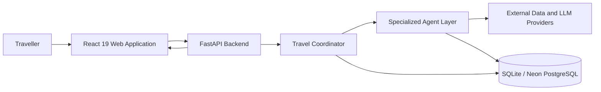
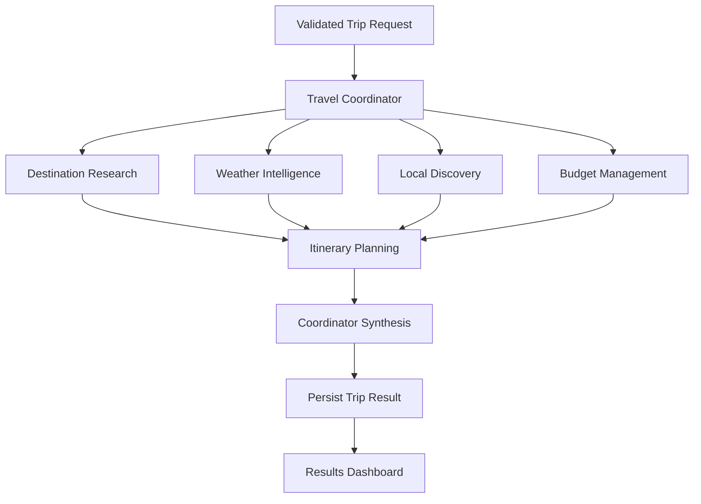
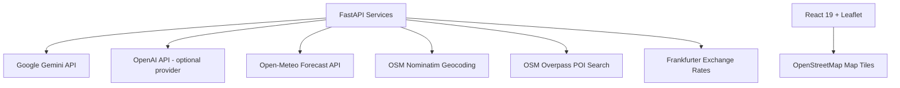

# TripMind AI — System Architecture

This document describes the current high-level architecture of TripMind AI.

## 1. System Context

## 2. Agent Collaboration

The coordinator owns the workflow. Independent research tasks run concurrently. Itinerary planning uses the collected research and planning outputs, and the coordinator synthesizes the completed result (see [Results Dashboard](screenshots/04-results-dashboard.png)).

## 3. Agent Responsibilities and Data Sources

| Agent | Responsibility | Primary Dependencies |
|---|---|---|
| **Destination Research** | Destination context, attractions, and practical tips | Gemini; Nominatim geocoding |
| **Weather Intelligence** | Forecast interpretation and weather-aware advice | Open-Meteo API; optional LLM reasoning |
| **Local Discovery** | Verified nearby places, dining, and regional guidance | Overpass; Nominatim; curated fallback behavior |
| **Budget Management** | Expense allocation, feasibility, and currency conversion | Frankfurter API; calculation logic; optional LLM |
| **Itinerary Planning** | Date-aware, geographically grouped daily schedule | Gemini synthesized with upstream agent outputs |
| **Travel Coordinator** | Pipeline orchestration, progress tracking, and final synthesis | Upstream agent outputs; Google Gemini |

## 4. Provenance Model

Agent metadata communicates how an output was produced:

| Source Type | Meaning |
|---|---|
| `llm` | Language-model-generated output |
| `live_api` | Data retrieved directly from a live external API |
| `hybrid` | Live external data combined with LLM reasoning |
| `fallback` | Local fallback logic used because a live dependency was unavailable |

The UI preserves these distinctions through dedicated badges, timing metrics, and source tags (see [Agent Execution Dashboard](screenshots/03-agent-dashboard.png)). A completed agent status means its task completed; it does not imply every external provider returned live data.

## 5. External Services

Public geospatial services may impose usage limits or experience congestion. If a place cannot be verified, the application must not invent its name, address, or coordinates. Currency fallback values are clearly marked as estimates.

## 6. Persistence and API Boundary

- FastAPI exposes trip-generation, trip-retrieval, deletion, agent-status, and server-sent-event routes.
- Dual-database architecture: SQLAlchemy 2 async models persist trip requests and generated plans in SQLite (`aiosqlite`) for local development and Neon PostgreSQL (`asyncpg`) for production cloud deployment.
- The frontend communicates with the backend through its centralized API service layer (`frontend/src/services/api.js`).
- Provider credentials and database passwords are configured exclusively on the backend and are never exposed to the browser.

## 7. Local Development Ports & Endpoints

| Service | Default URL |
|---|---|
| React 19 + Vite frontend | http://localhost:5173 |
| FastAPI backend | http://localhost:8000 |
| FastAPI interactive docs | http://localhost:8000/docs |
| Application health endpoint | http://localhost:8000/api/health |
| Database health endpoint | http://localhost:8000/api/health/db |
